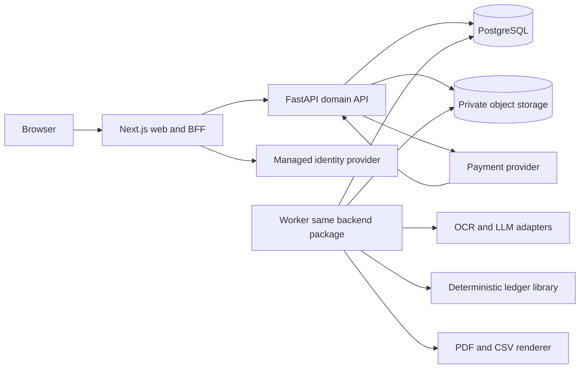
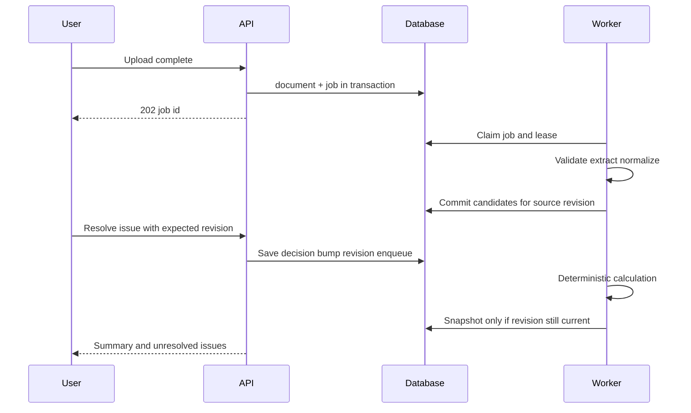
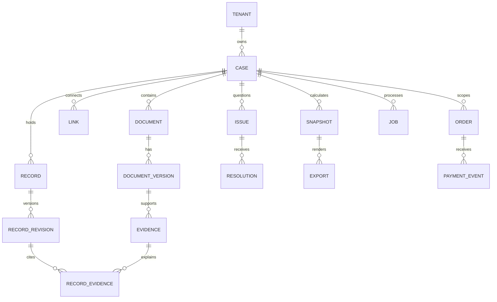

# RenoLedger полная спецификация проекта

Версия 0.1 · 14 ноября 2026 года

Описание продукта, техническое задание, UX, финансовые правила, архитектура, модель данных, API, качество, план разработки и платный пилот.

Статус: проектная спецификация. Приложение ещё не реализовано. Цена, спрос, расходы и преимущества требуют проверки. Весь демонстрационный материал синтетический.

Этот файл собран из разделов `docs/`. Для редактирования используйте исходные разделы и пересоберите комплект.

## Содержание

1. [Описание RenoLedger](docs/01_PRODUCT.md)
2. [Техническое задание первой версии](docs/02_REQUIREMENTS.md)
3. [Пользовательский путь и интерфейс](docs/03_UX.md)
4. [Правила расчётов и финансовая модель](docs/04_LEDGER_RULES.md)
5. [Архитектура RenoLedger](docs/05_ARCHITECTURE.md)
6. [Модель данных](docs/06_DATA_MODEL.md)
7. [Контракт API и интеграции](docs/07_API.md)
8. [Качество и эксплуатация](docs/08_QUALITY_OPERATIONS.md)
9. [План разработки и готовность](docs/09_DELIVERY.md)
10. [Пилот, цена и экономика](docs/10_PILOT_BUSINESS.md)
11. [Решения и источники](docs/11_DECISIONS_SOURCES.md)

## Описание RenoLedger

### Предложение

«Восстановите расчёты с подрядчиком перед следующим платежом. Узнайте, как получилась запрошенная сумма, какие платежи учтены и что осталось уточнить».

RenoLedger помогает владельцу жилья разобраться в документированной, но запутанной истории ремонта. Пользователь приходит с существующими файлами, а сервис предлагает их структуру и связи. Продукт не устанавливает качество выполненных работ, юридическую обязанность платить или правоту стороны спора.

### Первый покупатель

Владелец жилья в США, который самостоятельно ведёт ремонт, ожидает очередной или окончательный счёт и не может объяснить остаток. Уже существуют смета, изменения и несколько платежей. Сложность находится преимущественно в восстановлении связей, версий и зачётов.

Для хакатона основная аудитория — 25–45 лет. Возраст не заменяет проверку потребности. Отбор: текущий платёжный вопрос, несколько финансовых событий, достаточно определённые исходные документы, отсутствие удобного актуального расчёта.

Три группы случаев:

| Случай | Действие |
|---|---|
| Простой счёт и один очевидный платёж | Показать ограниченную пользу; не обещать экономию, оправдывающую $99 |
| Много документов, ясные условия, сложные связи | Основной пилотный сегмент |
| Устный спор, неясный состав работ, отсутствующие условия | Зафиксировать пробелы; не продавать установленный остаток как результат |

### Законченный результат

Один заказ привязан к подрядчику, текущему документу, согласованному набору источников и дате отсечения. Результат содержит четыре самостоятельные части:

1. Сколько запрошено в текущем документе.
2. Остаток по учтённым обязательствам и фактически совершённым платежам.
3. Что документы сообщают об условиях текущего платежа: срок, этап, приёмка.
4. Какие неизвестные и противоречия мешают окончательному объяснению.

Неопределённость может быть полезным результатом только при конкретном объяснении, каких сведений недостаёт. Если недостаточность очевидна до оплаты, её показывают до продажи. Продукт не обязан находить переплату в каждом проекте.

### Основной сценарий

Текущий счёт → извлечение его смысла → загрузка относящейся истории → предлагаемые связи → денежно значимые уточнения → воспроизводимый расчёт → сохранённый отчёт. Следующий документ создаёт новую версию расчёта, сохраняя предыдущий снимок.

Пример: смета $12 000, подтверждённые дополнения $1 500, согласованное уменьшение $800, платежи $8 000. Остаток по этим записям $4 700. Новый счёт просит $5 500. Сервис объясняет разницу $800 и её источники, но не объявляет сумму незаконной и не исправляет счёт подрядчика.

### Конкурентная позиция

Сведения проверены по публичным страницам 14.11.2026; платные сценарии на одинаковых клиентских документах ещё не сравнивались.

| Альтернатива | Уже заявленные возможности | Что предстоит доказать RenoLedger |
|---|---|---|
| ScopeCheckup, $19 за проверку / $49 до 10 проверок проекта | Сметы, счета, изменения, финансовая сводка, источники | Меньше действий для восстановления существующей истории, авансов и версий |
| Budget My Reno, $12,99 lifetime / $1,99 в месяц | OCR, расходы, график платежей, история, совместный доступ | Меньше ручной работы при восстановлении связей, а не просто вводе расходов |
| ReNovo, опубликованный Base €9,90/месяц без VAT; также заявлен Free | Распределения, частичные платежи, документы, зачёты и возвраты | Быстрее восстановить уже накопленную историю; ограничения Free ещё требуют проверки |
| Таблица и папка | Гибкий ручной учёт | Снижение полного времени до проверяемого результата |

Источники: [ScopeCheckup](https://www.scopecheckup.com/pricing), [Budget My Reno](https://budgetmyreno.com/), [ReNovo features](https://myrenovo.app/en/features), [ReNovo pricing](https://myrenovo.app/en/pricing).

Пакетная загрузка, OCR, правильное разделение сумм и ссылки на страницы не считаются доказанной уникальностью. Отсутствие функции в рекламе конкурента не доказывает её отсутствия в кабинете. Сравнение строится по времени клиента, количеству исправлений, корректности и цене результата.

### Первая версия и развитие

Первая версия: один подрядчик, фиксированные суммы и документированные изменения, один редактирующий владелец, USD, английские материалы. Платежи второго владельца или кредитора допускаются как отдельные источники без совместного редактирования.

После проверки основной задачи: несколько подрядчиков, перенос остатков в общую сводку, совместное редактирование, повторные сверки с отдельным предложением. Позже и отдельно: банковские интеграции, сложные time-and-materials договоры, полная почтовая интеграция, оценка прогнозной стоимости.

Не входят в начальное обещание: исполнение платежей, автоматическая отправка сообщений подрядчику, оценка работ по фото, юридическое разрешение спора, налоговые рекомендации, marketplace подрядчиков, интерьерное проектирование.

### Критерий успеха

Покупатель получает полезный результат самостоятельно, первая покупка покрывает переменные расходы и привлечение, а точность выдерживает независимую сверку. Возврат измеряется отдельно только среди клиентов с новым документом. Разовый автоматизированный результат после завершения ремонта может быть полноценным программным бизнесом.

## Техническое задание первой версии

Версия 0.1. Требования описывают целевое поведение; ни один пункт пока не помечен реализованным. P0 нужен для корректного сквозного сценария, P1 нужен до работы с реальными платными заказами, P2 — развитие после проверки.

### Пользователи и границы

Владелец видит только свои проекты. Демонстрационный посетитель работает исключительно с отдельными синтетическими данными. Оператор пилота может получить ограниченный доступ к явно разрешённому случаю; доступ, цель и срок фиксируются. Второй редактирующий владелец — P2.

Основной язык UI — English (US). Валюта — USD; суммы в целых центах. Даты документов — календарные даты в указанном контексте; серверные события — UTC. API возвращает идентификаторы и стабильные коды, интерфейс локализует пояснения.

### Функциональные требования

| ID | Приоритет | Поведение и приёмка |
|---|---|---|
| FR-01 | P0 | Создать case: один подрядчик, цель сверки, дата отсечения. Повтор запроса с тем же ключом не создаёт второй case |
| FR-02 | P0 | Загрузить текущий счёт PDF/JPEG/PNG. До подтверждения обработки показать тип, размер, количество доступных страниц и ошибки |
| FR-03 | P0 | Извлечь суммы, дату, тип счёта, признаки аванса/накопительного итога и ссылки на фрагменты. Неизвестное возвращается null |
| FR-04 | P0 | Добавить смету, изменения, чеки и подтверждения платежей. Документ может содержать несколько финансовых записей |
| FR-05 | P0 | Ручная запись платежа имеет происхождение user_statement. Она не маркируется банковски подтверждённой |
| FR-06 | P1 | CSV необязателен. Предпросмотр маппинга столбцов, локали, знака и статуса до импорта. Ошибочные строки не теряются молча |
| FR-07 | P0 | Предлагать связи документов, платежей, версий. Равенство сумм не достаточно для автоматического окончательного сопоставления |
| FR-08 | P0 | Выявлять дубли файлов и вероятные дубли событий. Различать идентичный файл и реально повторившийся платёж |
| FR-09 | P0 | Очередь вопросов сортируется по влиянию на деньги и зависимости. Видно, какие показатели изменит ответ |
| FR-10 | P0 | Подтверждения независимы: прочтение, смысл, связь, актуальность. Кто и что проверил — записывается отдельно |
| FR-11 | P0 | Считать обязательства, начисления, завершённые денежные операции, распределения и нераспределённые суммы отдельно |
| FR-12 | P0 | Накопительный счёт, нетто после аванса, возврат переплаты и заменённая смета проходят сценарии FIN-01…FIN-16 |
| FR-13 | P0 | Показывать четыре блока результата; условия этапа отделены от остатка договора и от запроса подрядчика |
| FR-14 | P0 | Каждая существенная сумма раскрывается до записей и источников. При неполноте результат обозначен предварительным |
| FR-15 | P0 | PDF/CSV экспорт фиксирует snapshot, дату, версии правил, оговорённый набор документов, происхождение и открытые вопросы |
| FR-16 | P0 | Изменение исходных данных повышает case_revision, инвалидирует зависимые проверки и сохраняет старый отчёт |
| FR-17 | P0 | Новый документ можно добавить к существующей истории; просмотр изменений не требует повторно вводить всё |
| FR-18 | P1 | Объём и цена заказа показываются до оплаты. Дополнительные события не обрабатываются платно без отдельного согласия |
| FR-19 | P1 | Оплата/возврат/статус получаются из проверенного webhook, а не из query-параметра после checkout |
| FR-20 | P1 | Удаление case прекращает задания и отзывает доступ; применяется регламент хранения и очистки |
| FR-21 | P0 | Публичное demo не требует входа, явно синтетическое, данные и бюджеты изолированы от клиентских |
| FR-22 | P1 | Записываются метрики времени, затрат на обработку, поддержки и отбора без содержимого документов в аналитике |
| FR-23 | P1 | Ошибка сервиса исправляется без нового платного заказа. Новое финансовое событие оформляется отдельно |
| FR-24 | P0 | Сбой/повтор worker не создаёт второй факт, платёж, отчёт или списание; видны состояние и возможность повторить |

### Нефункциональные требования

| ID | Проектный критерий |
|---|---|
| NFR-01 | Никаких float в учёте денег; валидатор отвергает дробное количество центов |
| NFR-02 | Одинаковые принятые записи + версия правил дают одинаковый расчёт и fingerprint |
| NFR-03 | Доступ к каждому case/document/job/export проверяется на сервере по владельцу |
| NFR-04 | Исходные файлы приватны; права на временную ссылку проверяются при её выдаче; источник не публикуется как постоянный URL |
| NFR-05 | Обработка документов асинхронна и переживает перезапуск API/worker |
| NFR-06 | Предлагаемый SLO: p95 обычного API до 500 мс при согласованном нагрузочном профиле, без внешнего OCR/LLM. Проверяется отдельно |
| NFR-07 | Предлагаемая цель: предварительное извлечение 10 читаемых страниц p95 до 120 с при 3 параллельных заданиях на тестовом окружении. Не клиентская гарантия |
| NFR-08 | Клавиатура, видимый focus, текстовые ошибки, семантические таблицы; статус не кодируется только цветом |
| NFR-09 | При недоступности AI сохранённый расчёт и экспорт доступны; новые документы ожидают обработки |
| NFR-10 | Ограничения API, файлов, страниц, повторов и бюджета задаются сервером; demo не имеет неограниченного AI-доступа |
| NFR-11 | Секреты/выписки/тексты документов отсутствуют в исходном репозитории, telemetry и error tracking |
| NFR-12 | Платный запуск возможен после проверки восстановления backup, изоляции данных и удаления |

### Технические ограничения пилота

Предлагаемые начальные пределы: 20 MiB на файл, 50 страниц на файл, 200 страниц и 5 000 CSV-строк на case до отдельной проверки нагрузки. Это защитные ограничения платформы, а не купленный коммерческий объём. Оплачиваемый комплект описывается manifest; перед оплатой техническая пригодность проверяется. Идентичные повторные файлы не увеличивают объём работы.

Защищённый паролем PDF, неподдерживаемый формат, повреждённый файл и иной язык получают понятное сообщение. Архивы, исполняемые файлы и произвольные URL для скачивания не принимаются.

### Приёмка сквозного сценария

1. Пользователь загружает текущий счёт, смету и подтверждения платежей.
2. OCR/LLM формирует кандидатов, а не окончательные денежные события.
3. Пользователь видит источники, разрешает существенную неоднозначность.
4. Детерминированный расчёт показывает запрошенную сумму, остаток, условия и пробелы.
5. PDF и CSV соответствуют одному snapshot; повторный экспорт не меняет цифры.
6. Добавление новой версии документа помечает старые зависимые проверки устаревшими.
7. Чужой пользователь не может прочитать ни один объект через API или storage.

Скорость и стоимость измеряются на реальных комплектах отдельно от прохождения этих технических критериев.

## Пользовательский путь и интерфейс

### Принципы

Пользователь должен понять текущий счёт раньше, чем соберёт весь ремонт. Вопросы касаются прежде всего денег. Каждое число раскрывается до источника. Неизвестные данные сохраняются как неизвестные. Термины интерфейса описывают бытовую задачу, не внутреннюю архитектуру.

Английская главная фраза: **Understand your contractor's payment request.** Подзаголовок: **Bring your estimate, invoices and payment records together. See how the amount was calculated and what still needs clarification.**

Не использовать: «You are being overcharged», «Safe to pay», «Guaranteed savings», «Verified debt» без установленных оснований. Завершение обработки не означает, что платёж можно совершать.

### Экраны

| Экран | Содержимое | Основное действие |
|---|---|---|
| Landing | Проблема, понятный пример, граница результата, pilot price | Try sample / Review my invoice |
| Demo | Синтетическая история, источники, исправление связи, живой перерасчёт | Explore the calculation |
| New case | Имя подрядчика, текущий счёт, дата отсечения | Upload current invoice |
| Intake | Тип и качество файла, текущая запрошенная сумма, недостающие материалы | Add supporting records |
| Document workspace | Список файлов слева, PDF/изображение в центре, извлечённые сведения справа | Review extracted details |
| Questions | Один денежно значимый вопрос, источники и влияние ответа | Link / Keep separate / I don't know |
| Summary | Четыре отдельных блока, неполнота и изменения | View calculation / Export |
| Offer | Зафиксированный комплект, результат, цена, ручное участие, границы уточнений | Purchase this review |
| History | Версии документов и расчётов, причина изменений | Compare snapshots |
| Settings | Экспорт, доступ оператора, удаление | Delete case |

### Первый результат

После извлечения текущего счёта: «This invoice requests $5,500. It mentions a previous deposit. Add the deposit record and accepted estimate to check the calculation». До проверки нельзя показывать $5,500 как установленную задолженность.

### Макет сводки

```text
Kitchen contractor · Records through 14 Nov 2026
Status: Provisional — 1 issue affects the calculation

REQUESTED IN THIS INVOICE       $5,500
REMAINING UNDER RECORDED TERMS  $4,700
CURRENT PAYMENT CONDITIONS     Final-stage acceptance mentioned
NEEDS CLARIFICATION             $800 material credit

[Explain the $800 difference]  [View sources]  [Export]

Recorded terms: 12,000 + 1,500 - 800 = 12,700
Completed net payments: 8,000
Remaining under recorded terms: 4,700

The invoice requests 5,500. These figures do not establish
whether the work has been accepted or payment is currently due.
```

Для русскоязычного pitch можно переводить пояснения; рабочий consumer UI остаётся английским.

### Вопросы

Карточка содержит источник, денежное влияние, конкретные варианты и «I don't know». Пример: «Does this $3,000 transfer belong to this contractor? Linking it will increase recorded payments by $3,000. It is currently unallocated».

Нельзя массово подтверждать денежно значимые неоднозначности одной кнопкой «Confirm all». Неоднозначный адрес, который не влияет на принадлежность записи, не блокирует расчёт. Если принадлежность подрядчику сама неясна, это денежно значимый вопрос.

Нажатие «прочитано верно» подтверждает извлечение; «это действующая версия» — выбранную связь версий; «я согласовал изменение» — заявление пользователя о согласовании. Эти действия имеют разные подписи.

### Ошибки и пустые состояния

- Нет исходной сметы: доступны суммы счёта и зарегистрированные платежи, остаток договора — Unknown.
- OCR низкого качества: показать страницу, предложить заменить изображение или ввести значение со ссылкой.
- Неподдерживаемый CSV: предпросмотр первых строк и настройка колонок; без тихого отбрасывания строк.
- Платёж не сопоставлен: виден в отдельном списке; не уменьшает конкретный счёт автоматически.
- Одновременная правка из второй вкладки: показать новую версию; не перезаписывать молча.
- Провайдер временно недоступен: файлы сохранены, задание ожидает; не предлагать оплатить повторно.
- Case вне поддерживаемого объёма: показать причину до продажи, дать удалить материалы.
- Удаление: явно указать набор данных, последствия для отчётов и политику backup.

### Покупка и последующая работа

До checkout показывается manifest источников и cutoff. В пилот входит один объединённый раунд уточнений по фактам этого комплекта. Уточнение существующего события не равно новому финансовому событию. Исправление ошибки сервиса не продаётся как новый заказ.

Новый счёт можно сохранить и увидеть, что требуется новая сверка; платная обработка запускается только после отдельного предложения. История остаётся доступной в объявленный срок хранения. Сроки хранения и повторной обработки не должны появляться впервые после покупки.

### Доступность

Макеты для 360, 768 и 1440 px; таблицы на мобильном имеют читаемые карточки/горизонтальную прокрутку без скрытия важных значений. Денежные знаки и отрицательные суммы сохраняются. Кнопки имеют однозначные accessible names, ошибки связаны с полем, loading объявляется screen reader. В просмотрщике источник открывается по клавиатуре и возвращает focus.

## Правила расчётов и финансовая модель

Этот файл задаёт смысл чисел RenoLedger. Расчётчик принимает нормализованные записи с доказательствами и выбранной версией истории. OCR и LLM не имеют права напрямую менять денежный итог.

### Разные сущности

| Сущность | Смысл |
|---|---|
| Agreement | Выбранная действующая база стоимости подрядчика |
| Commitment adjustment | Отдельное изменение договорённой стоимости, ещё не включённое в выбранную базу |
| Billing entry | Уникальное начисление либо корректировка начисления; не обязательно денежное движение |
| Payment request | Сумма, которую просит текущий документ; может включать старый долг и вычитать аванс |
| Cash event | Завершённый исходящий платёж или входящий возврат, либо отдельно обозначенное незавершённое событие |
| Allocation | Связь части завершённого платежа с конкретным начислением |
| Terms | Дата/этап/приёмка/удержание, от которых документ связывает текущий платёж |
| Evidence | Фрагмент документа, строка выписки или заявление пользователя |

Бюджет хозяина не является обязательством перед подрядчиком. Счёт не доказывает факт оплаты. Банковское списание не доказывает, что весь перевод относится к этому ремонту. Пользовательское подтверждение не устанавливает юридическую действительность обязательства.

### Денежные представления

В БД/API используются signed int64 cents, currency = USD. Публичный безопасный диапазон ограничен ±9 000 000 000 000 cents, чтобы значения точно представлялись также в JavaScript. Суммы не проходят через binary float. Проценты и количества из документов сначала обрабатываются Decimal; правило округления указывается у вычисленного результата. Документальный итог и пересчитанный итог сохраняются отдельно, расхождение не скрывается.

Исходящие деньги к подрядчику положительны; возвраты от него отрицательны в нормализованном cash ledger. CSV-адаптер хранит исходный знак, тип и выбранное правило преобразования. Валюта и локаль определяются до преобразования, строка `1,250` не интерпретируется по догадке.

### Основные величины

Для одного подрядчика на дату отсечения:

```text
C = current accepted agreement + effective commitment adjustments
B = effective distinct billing entries + effective billing credits
P = completed outgoing cash - completed cash refunds
R = C - P
U = P - net amount allocated to billing entries
```

`R` — остаток по учтённым договорённостям. Он не равен сроку наступления платежа и не означает разрешение платить. Если R отрицателен, показывается кредитовый остаток по учтённым записям; не применять clamp(0).

`C` неизвестен при отсутствии выбранной базы; тогда R = null. Если история имеет известные неполные элементы, C/P/R могут показываться как provisional с перечислением пробелов. Неизвестное обязательство не заменяется нулём.

Нераспределённые по счетам платежи, уверенно отнесённые к подрядчику, входят в P и R, но не уменьшают случайный счёт. Неизвестный получатель исключается из contractor P до выяснения и показывается отдельным вопросом.

Для каждой действующей позиции начисления: `open_i = charge_i - net_allocation_i`. Показывать суммы положительных остатков отдельно от кредитовых остатков и нераспределённых авансов. `B-P` не выдавать за точный текущий долг, если распределения неполны. Глобальное сальдо и задолженность конкретного счёта — разные поля.

`requested_now` берётся из текущего документа. `documented_stage_amount`, `due_date` и `condition_text` описывают условия, а `condition_satisfaction` может быть unknown или user_reported. Приложение не проверяет выполнение строительных работ.

### Нормализация документов

#### Версии обязательств

Обновлённая смета может заменять старую, включать прежние изменения или добавлять новую работу. Связи `supersedes`, `includes_adjustment` и `amends` сохраняются явно. Если смета $12 000 заменена итогом $13 500, включающим допработы $1 500, C = $13 500, а не $15 000. При неясной области замены вычисление помечается provisional.

#### Виды выставления сумм

Каждый документ имеет отдельный proposed billing basis:

- `incremental_charge`: новое начисление за отдельный объём, можно добавлять к B после устранения пересечений.
- `cumulative_valuation`: начислено всего с начала работ. При сопоставимой области и известном предыдущем накопительном начислении новое приращение = current cumulative - previous cumulative. Предыдущие платежи не заменяют предыдущие начисления.
- `balance_statement`: документ сообщает остаток после старых начислений/платежей. Сохраняется requested_now; новое начисление не создаётся автоматически.
- `credit_note`: корректирует определённое начисление. Изменение C требует отдельного основания.
- `unknown`: требуется уточнение.

Пример: ранее начислено $5 000, оплачено $3 000, теперь начислено накопительно $13 500 и запрошено $10 500. Новое начисление — $8 500; совокупный открытый остаток — $10 500. Вычитание $3 000 из $10 500 ещё раз ошибочно.

Начисления должны иметь coverage: какие работы/периоды/предыдущие документы включены. При неизвестном пересечении не суммировать всё как независимые счета.

#### Аванс

Аванс — cash event и возможный нераспределённый кредит. Счёт с «less deposit» ссылается на уже существующий платёж, не создаёт новый cash event и не уменьшает обязательство. Если документ уже содержит balance due, баланс показывается как запрошенный, а аванс применяется один раз в восстановленной истории.

#### Возврат и зачёт

Возврат переплаты уменьшает P, не C. При C=$10 000, исходящих $11 000 и возврате $1 000 получаем P=$10 000 и R=$0.

Кредит за исключённые работы может изменить C и B, если это подтверждают отдельные смыслы документа; это не две независимые экономии. Cash refund создаётся только при фактическом движении денег. Возврат средств не является автоматически уменьшением объёма работ.

#### Покупки хозяина

Самостоятельная покупка — отдельный расход владельца. В первой версии он влияет на contractor C только через явное согласованное уменьшение. Покупка материалов $800 и зачёт $800 подрядчиком не должны одновременно уменьшать C дважды. Полный проектный бюджет отложен, но источник зачёта сохраняется.

#### Состояния оплаты

`pending`, `scheduled`, `failed`, `reversed` не равны completed. Пользователь может заявить, что платёж завершён; происхождение остаётся user_statement, а не bank_record. Откат ранее проведённой операции сохраняет историю и перестраивает её вклад, не удаляя исходный факт.

Перевод второго владельца/кредитора допускается с payer и evidence. Отсутствие такой операции в выписке владельца аккаунта не доказывает отсутствия оплаты.

#### Дубли

SHA-256 идентичного файла позволяет не создавать повторный upload artifact в одном case. Совпадение файла не равно правилу дублей банковских событий. Предпочтителен устойчивый bank transaction id + account fingerprint. При его отсутствии используется кандидат на дубль по дате, сумме, описанию и контексту импортов, с проверкой пользователем. Два реальных одинаковых перевода нельзя автоматически слить.

#### Изменения и конфликт

Исходный файл immutable. Исправление создаёт новую document revision/новое решение. Любое изменение денежного смысла повышает case_revision и делает зависимые resolutions/snapshot неактуальными. Старый отчёт остаётся снимком прежних данных. Ответ на устаревший вопрос не принимается без повторного открытия текущей версии.

### Инварианты расчётчика

1. Один нормализованный денежный факт входит в выбранную историю не более одного раза.
2. Нельзя распределить положительный платёж сверх доступного остатка; возврат корректирует конкретные связанные распределения или остаётся явно нераспределённым.
3. Сумма распределений + нераспределённая часть равна cash event amount с учётом его направления.
4. Изменение requested_now само по себе не изменяет C или P.
5. Возврат сам по себе не изменяет C.
6. Неактивная версия не участвует в текущем итоге, но остаётся доступной как источник.
7. Изменение порядка загрузки без изменения решений не меняет итог.
8. Повтор задания/импорта не меняет число признанных событий.
9. Каждое значение имеет ancestry до источника/заявления; каждый snapshot имеет case_revision и rules_version.
10. Сохранённый snapshot не содержит результатов worker от другой ревизии.

### Контрольные сценарии

Машиночитаемые примеры находятся в [ledger_cases.json](fixtures/ledger_cases.json). Они содержат постановку, ожидаемую нормализацию, суммы и предупреждения. Нормализация в fixture дана как эталон и не доказывает способность AI самостоятельно получить её.

| ID | Проверяемое свойство |
|---|---|
| FIN-01 | Смета, изменение, зачёт, оплаты и расхождение текущего счёта |
| FIN-02 | Аванс уже вычтен из payment request |
| FIN-03 | Обновлённая смета включает допработы |
| FIN-04 | Возврат переплаты не меняет C |
| FIN-05 | Остаток договора отличается от текущего этапа |
| FIN-06 | Неопределённая база даёт null остаток |
| FIN-07 | Pending платёж не включается в completed P |
| FIN-08 | Перекрывающиеся CSV не удваивают known transaction |
| FIN-09 | Два реальных одинаковых перевода сохраняются |
| FIN-10 | Оплата кредитором включается с собственным evidence |
| FIN-11 | Накопительное начисление и старый непогашенный счёт |
| FIN-12 | Зачёт не тождествен денежному возврату |
| FIN-13 | Нераспределённый по счетам аванс сохраняет R |
| FIN-14 | Отрицательный R показывается, не обнуляется |
| FIN-15 | Только относящиеся к проекту позиции покупки |
| FIN-16 | Нераспределённый неизвестному получателю перевод не уменьшает contractor R |

Отдельные интеграционные проверки: новая версия инвалидирует подтверждение, конфликт optimistic concurrency, повтор worker, случайное изменение порядка импорта, смешанный документ с несколькими счетами, изменение cutoff, откат платежа и сохранение старого отчёта.

## Архитектура RenoLedger

### Структура системы

Один backend как модульное приложение, отдельный worker из того же кода, один PostgreSQL и приватное объектное хранилище. Это позволяет разделить HTTP и длительную обработку без сети микросервисов. Реализация ещё не создана.



Browser получает временный upload URL только после авторизации; фактические байты может передавать напрямую в quarantine storage. На схеме это дополнительный data path, минующий BFF. Право просматривать исходники проверяется сервером отдельно.

### Выбранный стек

| Слой | Выбор | Причина |
|---|---|---|
| UI | Next.js App Router, TypeScript, React, доступные компоненты | Документы, формы, источник и таблицы в браузере |
| BFF | Тонкие Next.js route handlers | Cookie session и проксирование; без финансовой логики |
| API | Python, FastAPI, Pydantic strict schemas | Типизированные контракты и удобная обработка документов |
| Persistence | PostgreSQL, SQLAlchemy, Alembic | Транзакции, связи, история и очередь первого этапа |
| Worker | Отдельный процесс того же Python приложения | OCR/LLM/экспорт переживают завершение HTTP-запроса |
| Files | Приватное S3-compatible storage | Исходники, страницы и отчёты с ограниченным доступом |
| Auth | Managed OIDC provider, серверная сессия BFF | Не разрабатывать хранение паролей самостоятельно |
| AI | Provider-neutral adapter с JSON Schema | Замена провайдера и измерение стоимости без изменения ledger |
| Payments | Hosted checkout и проверенные webhooks | Провайдер выбирается после проверки доступности аккаунта продавца |
| Tests | pytest, Hypothesis, Playwright, API contract validation | Инварианты денег, изоляция, сквозные сценарии |

Точные стабильные версии зависимостей фиксируются lockfile при старте реализации после проверки совместимости. Разработка документации выполнена с локальным Python 3.10; это не решение о production runtime. Предпочтение для реализации — поддерживаемая stable Python 3.12+ и поддерживаемая LTS Node, доступные хостингу; проверить версии в этапе DEV-01.

### Модули backend

`identity` проверяет access context; `cases` хранит границы сверки; `documents` управляет uploads и evidence; `extraction` вызывает adapters; `normalization` создаёт кандидатов; `ledger` считает; `review` управляет вопросами/решениями; `reports` создаёт snapshots; `orders` обрабатывает manifest/платежи; `jobs` исполняет очередь; `telemetry` агрегирует затраты; `privacy` удаляет данные.

Ledger — pure domain package без сетевых вызовов, OCR, UI или SQL. Его вход — строго валидированный выбранный набор нормализованных событий, выход — суммы, происхождение и предупреждения. Запись решения пользователя и постановка recalculation job выполняются в одной DB-транзакции.

### Pipeline

1. Авторизованный запрос создаёт immutable document id и upload attempt.
2. Сервер выдаёт краткоживущий URL для уникального quarantine key. Клиент сообщает о завершении.
3. Worker проверяет размер, MIME по содержимому, checksum, страницы и пригодность. Парсер запускается в изоляции с лимитами памяти/времени и без произвольного сетевого доступа.
4. Принятые байты копируются в immutable final key либо фиксируется неизменяемая версия объекта. Нельзя продолжать читать изменяемый upload key: presigned URL может использоваться повторно до истечения срока.
5. Native text извлекается по страницам; OCR применяется к нужным страницам. Evidence хранит страницу, диапазон текста и bbox при наличии.
6. LLM возвращает кандидатов по `extraction.schema.json`. Текст документа — данные, не инструкции для приложения. Модель не вызывает платежи, рассылки или произвольные URL.
7. Валидаторы проверяют схему, денежные форматы, суммы строк, доказательства и тип начисления. Некорректный ответ не коммитится как факт.
8. Normalization предлагает версии, связи и вопросы; неясности получают явную причину.
9. Пользователь фиксирует решения на конкретной case_revision. Значимые изменения инвалидируют зависимые проверки.
10. Ledger создаёт immutable snapshot; renderer формирует PDF/CSV из этого snapshot, а не пересчитывает иначе.



### Очередь и согласованность

PostgreSQL jobs используют короткий `SELECT ... FOR UPDATE SKIP LOCKED`, lease и `available_at`. Транзакция claim завершается до сетевого OCR/LLM-вызова. Worker отправляет heartbeat, просроченный lease возвращает работу в очередь. Один и тот же job может исполниться несколько раз; effect deduplication обеспечивается уникальным job_key и идемпотентной записью результатов.

Ключ извлечения: document_version + content_hash + extractor_version + schema_version. Ключ расчёта: case_id + case_revision + rules_version. При публикации проверяется ожидаемая ревизия: устаревший результат сохраняется диагностически или отбрасывается, но не становится latest.

Все мутации case выполняются под короткой блокировкой case row и expected_revision. Deadlock/transient failure повторяется ограниченно. Любая смена фактов, связей, принятой версии и cutoff увеличивает revision. Изменение профиля без влияния на расчёт не обязано её менять.

Ретраи внешних вызовов ограничены попытками и бюджетом; exponential backoff с jitter. Ошибки формата, неподдерживаемые документы и бюджетный лимит не ретраятся бесконечно. FastAPI BackgroundTasks не используется как надёжная очередь тяжёлой обработки.

### Auth и границы доверия

BFF хранит secure HttpOnly session cookie, backend принимает короткоживущий подписанный access token. API проверяет подпись, issuer, audience и expiration; owner_id никогда не берётся из тела запроса. Серверные cookie-мутирующие маршруты требуют CSRF-защиты и проверки Origin. Не хранить refresh token в localStorage.

Все repository methods получают access context. Запросы ограничены tenant_id; child object дополнительно связан с авторизованным case. Operator grant отдельный, ограничен case и сроком, не превращает оператора в глобального администратора. Demo имеет отдельный namespace/tenant и не принимает клиентские идентификаторы из другого окружения.

### Развёртывание

Локально: web, API, worker, PostgreSQL и S3-совместимый эмулятор в Docker Compose. Staging и production имеют разные БД, buckets, identity/payment secrets. Для production — managed Postgres, private storage, контейнерные API/worker, TLS и managed identity. Конкретные аккаунты, регионы и расходы — решения перед подключением, не созданные ресурсы.

API stateless; worker concurrency регулируется бюджетом. Начально достаточно одного worker процесса с малой конкурентностью. Масштабировать очередь/отдельные сервисы только после метрик. Миграции запускаются один раз отдельным release job. Rollback приложения должен читать совместимую схему; разрушительные изменения — через expand/contract.

### Предлагаемая структура будущего репозитория

```text
apps/web/                    # Next.js UI and thin BFF
services/backend/app/
  api/ identity/ cases/ documents/ extraction/
  normalization/ ledger/ review/ reports/ orders/
  jobs/ privacy/ telemetry/
services/backend/migrations/
services/backend/tests/
infra/                       # compose and deployment manifests
contracts/ fixtures/ docs/  # this specification
```

Структура — план. Эти каталоги приложения не созданы документацией.

### Источники технических решений

[FastAPI Background Tasks](https://fastapi.tiangolo.com/tutorial/background-tasks/) — граница in-process background tasks; [PostgreSQL locking](https://www.postgresql.org/docs/current/explicit-locking.html) — транзакционные блокировки; [Next.js Route Handlers](https://nextjs.org/docs/app/getting-started/route-handlers) — слой BFF; [S3 presigned URLs](https://docs.aws.amazon.com/AmazonS3/latest/userguide/using-presigned-url.html) — ограниченные по времени ссылки и повторное использование ключа. Архитектура очереди и ledger — проектное решение RenoLedger, не готовая гарантия этих продуктов.

## Модель данных

Модель описывает PostgreSQL-схему для реализации миграциями. Это не применённая БД. UUID — внутренние идентификаторы; денежные значения — BIGINT cents; серверные даты — timestamptz; исходные даты — date с контекстом. Все бизнес-таблицы содержат tenant_id, created_at и собственный id.

### Связи



### Сущности и поля

| Таблица | Существенные поля и назначение |
|---|---|
| tenants | id, owner_subject уникальный у identity provider, status, retention_policy_version |
| cases | tenant_id, contractor_display_name, currency='USD', cutoff_date, purpose, revision, status, latest_snapshot_id |
| documents | case_id, logical_name, document_kind, active_version_id; логическая группа версий |
| document_versions | case_id, document_id, version_no, content_hash, immutable_storage_key, MIME, bytes, pages, ingestion_status, extracted_at |
| evidence | case_id, document_version_id nullable, page nullable, bbox nullable, text_range, csv_row nullable, short_quote, source_type, actor_id; неизменяемая ссылка на источник |
| extractions | case_id, document_version_id, extractor_version, schema_version, raw_output_key, validation_status, usage/cost, unique extraction_key |
| records | case_id, kind, current_revision_id; стабильная идентичность финансовой записи |
| record_revisions | case_id, record_id, number, kind, amount_cents nullable, currency, effective_date, payload, independent evidence/review/lifecycle flags, actor_id, reason |
| record_evidence | case_id, record_revision_id, evidence_id, relation_type; несколько доказательств одной записи |
| links | case_id, from_record_id, to_record_id, kind, amount_cents nullable, status, basis_revision, evidence_ids, superseded_by |
| issues | case_id, code, priority, affected_record_ids, impact_cents nullable, affected_metrics, status, basis_revision |
| resolutions | case_id, issue_id, answer, actor_id, actor_role, scope_of_verification, basis_revision, evidence_ids, invalidated_at |
| snapshots | case_id, case_revision, rules_version, input_fingerprint, input_manifest, result_json, status; immutable после создания |
| exports | case_id, snapshot_id, format, object_key, checksum, status, expires_at |
| orders | case_id, snapshot_goal, cutoff_date, manifest_hash, offered_price_cents, currency, state, human_review_disclosed, terms_version |
| payment_events | order_id, provider, provider_event_id unique, event_type, amount_cents, payload_hash, received_at; не путать с платежами подрядчику |
| jobs | case_id, job_key unique, type, expected_case_revision, payload, status, attempt, lease_owner, lease_until, available_at, last_error_code |
| idempotency_keys | tenant_id, route, key, request_hash, response_reference, expires_at |
| audit_events | case_id nullable, actor, action, object_type/id, before/after reference, revision, reason; без копий полных документов |
| support_grants | case_id, operator_subject, purpose, consent_at, expires_at, revoked_at |
| usage_events | case_id nullable, job_id nullable, stage, provider, units, cost_estimate, actual_cost nullable, human_seconds, attribution |
| deletion_requests | tenant_id, case_id nullable, state, requested_at, completed_at, provider_cleanup_state, backup_expiry_at |

Крупный OCR-текст и raw model output хранятся как приватные объекты с той же политикой удаления. В БД находятся структурированные данные и короткие необходимые фрагменты.

### Независимые признаки достоверности

Нельзя объединять эти поля в один status:

| Измерение | Значения |
|---|---|
| origin | document, bank_record, user_statement, derived |
| extraction_review | unreviewed, checked, corrected; кто проверил и что |
| semantic_review | unknown, user_asserted, reviewed_for_calculation |
| link_review | proposed, accepted, rejected, invalidated; относится к конкретной link |
| lifecycle | active, superseded, void, stale |
| conflict | zero or more issue ids |

`reviewed_for_calculation` не означает юридически подтверждённую обязанность. Проверка числа и выбор трактовки начисления — разные review actions с actor, timestamp, evidence и basis_revision.

### Record kinds и payload

- agreement_base: amount_cents, replaces_record_id, included_adjustment_ids, scope_text.
- commitment_adjustment: signed amount_cents, approval_origin, effective_date, included_in_base_id nullable.
- billing_entry: signed amount_cents, invoice_number, billing_basis, coverage_ids, replaces_entry_ids, gross_total_cents/previous_billed_cents nullable.
- payment_request: requested_now_cents, invoice_record_id, prior_payments_mentioned_cents, terms_reference; не изменяет B напрямую.
- cash_event: signed amount_cents, state, payer_type, method, transaction_fingerprint, external_account_fingerprint, original_transaction_id nullable.
- payment_terms: due_date, stage_description, stage_amount_cents nullable, acceptance_condition, condition_satisfaction, satisfaction_origin.
- owner_purchase: line amounts, selected_lines, prorated tax/shipping with method, linked_commitment_adjustment_id nullable.

Payload валидируется отдельной Pydantic/JSON-схемой по kind. Произвольный JSON не заменяет проверку бизнес-правил.

### Ограничения целостности

1. У child-таблиц составной FK `(tenant_id, case_id)` к case; связи document/record/evidence должны указывать на объекты того же case. UUID сам по себе не обеспечивает изоляцию.
2. `(document_id, version_no)` и `(record_id, revision_no)` уникальны. Один active_revision pointer на логический объект.
3. Изменения version pointers и увеличение case.revision в одной транзакции под case lock.
4. После записи snapshot нельзя менять result_json; новый расчёт создаёт новый snapshot.
5. Allocation проверяет типы концов, валюту, направление, сумму и lifecycle. Суммарные ограничения проверяются под блокировкой записей/события, не только CHECK одной строки.
6. В документальном состоянии completed денежных событий отсутствующий amount не допускается. Неизвестная сумма остаётся кандидатом, не признанным cash event.
7. Idempotency key при повторном запросе с иным request_hash возвращает conflict.
8. Внешний provider_event_id уникален; повтор webhook не создаёт второй entitlement.
9. Запись tenant_id не принимается от клиента. Операторский доступ требует действующего grant на этот case.
10. Аналитика не содержит адреса, получателей переводов, имён файлов, текстов чеков или коротких цитат.

### Индексы и хранение

Индексы: tenant/case для каждого списка; `(case_id, effective_date)` для истории; `(case_id, status, priority)` для вопросов; `(status, available_at)` для очереди; `(case_id, case_revision, rules_version)` для snapshots; уникальные ключи внешних платежных событий и извлечений.

Fingerprint не заменяет исходный источник. Audit не должен бессрочно сохранять клиентские данные после удаления: финансовые ссылки и payload удаляются/обезличиваются по политике, минимальные security events сохраняются только в объявленном объёме. Платёжные бухгалтерские записи провайдера имеют отдельную политику и не требуют хранить документы ремонта.

### Состояния

Case: draft → collecting → reviewing → snapshot_ready; возможны needs_input, processing_failed, archived, deletion_pending, deleted. snapshot_ready означает технически сформированную сводку, а не отсутствие неизвестных.

Job: queued → running → succeeded; временная ошибка → retry_wait; терминальная → failed; удаление case → cancelled. Lease expiry возвращает в очередь в пределах attempt/cost limits.

Order: draft_offer → offered → payment_pending → paid → in_progress → delivered; отдельно cancelled/refund_pending/refunded. Исправление ошибки результата не меняет paid order на новый заказ. Provider state и внутреннее состояние обновляются транзакционно с audit.

## Контракт API и интеграции

Машиночитаемый контракт: [openapi.json](contracts/openapi.json), OpenAPI 3.1. Все endpoint являются проектными и ещё не запущены. Base URL `/api/v1`. Идентификаторы UUID, суммы — integer cents, время событий — ISO 8601 UTC.

### Авторизация

Private API принимает Bearer access token от доверенного identity provider; BFF использует серверную сессию. Проверка владельца обязательна даже после проверки JWT. Неавторизованный доступ к чужому id возвращает 404, чтобы не раскрывать существование объекта. 401 — нет действующей сессии, 403 — известный пользователю объект и недостаточное разрешение/entitlement.

Demo GET не требует авторизации и возвращает только закреплённый синтетический пример. Запись demo — локальная браузерная копия или отдельный изолированный сеанс с лимитами; private endpoint никогда не отключает auth из-за demo flag клиента.

### Семейства маршрутов

| Область | Операции |
|---|---|
| Cases | POST/GET cases, GET/PATCH/DELETE case |
| Documents | create upload intent, complete upload, list, source access |
| Jobs | получить статус и ошибку; повтор через новую идемпотентную операцию обработки |
| Extraction | запустить обработку выбранных документов; вернуть 202 и job id |
| Records | список, создание пользовательской записи, изменение через новую ревизию |
| Links | создание/отклонение/замена связи, включая allocation |
| Issues | список вопросов и resolution с ожидаемой ревизией |
| Calculations | поставить recalculation, получить summary и snapshots |
| Exports | создать из snapshot, получить статус и временную ссылку |
| Orders | получить предложение, подтвердить согласие, начать checkout, получить статус |
| Provider events | webhook по подписи провайдера, без пользовательского JWT |
| Support/privacy | дать/отозвать case grant, проверить status удаления |

### Конкурентные изменения

Мутации денежного смысла содержат `expected_revision` и `Idempotency-Key`. API блокирует case, сравнивает revision, валидирует изменение и коммитит новую revision вместе с job. При расхождении — 409 `REVISION_CONFLICT`, с current_revision. Клиент заново читает изменённые данные; автоматическое перетирание ответа запрещено.

Повтор с тем же ключом и телом возвращает прежний результат; с другим телом — 409 `IDEMPOTENCY_CONFLICT`. Идемпотентность не отменяет проверку текущего доступа. TTL ключей не может быть короче окна автоматических клиентских повторов; проектный минимум 24 часа, внешние платёжные события дедуплицируются без этого короткого TTL.

### Ошибки

```json
{
  "code": "REVISION_CONFLICT",
  "message": "The case changed. Review the latest version before saving.",
  "request_id": "opaque-request-id",
  "current_revision": 7,
  "retryable": false
}
```

Стабильные коды: VALIDATION_ERROR, UNSUPPORTED_DOCUMENT, UNREADABLE_DOCUMENT, PAGE_LIMIT, BUDGET_LIMIT, REVISION_CONFLICT, IDEMPOTENCY_CONFLICT, SOURCE_CHANGED, ACCESS_DENIED, CHECKOUT_UNAVAILABLE, PROVIDER_TEMPORARY_FAILURE, DELETION_PENDING. Стек исключения, prompt и текст документа не возвращаются в публичной ошибке.

422 — структурная/семантическая ошибка входа; 413 — размер; 415 — формат; 429 — лимит с Retry-After; 503 — временная недоступность. Failed asynchronous job имеет error_code и retryability; HTTP 200 его статуса не означает успешное выполнение.

### Upload contract

Intent принимает имя для отображения, предполагаемый MIME, размер и checksum. Сервер возвращает document_id, upload_id, URL, method, required_headers и expiry. Complete вызывает проверку фактического объекта, а не доверяет имени или checksum браузера. Не принимать произвольный remote URL. Source endpoint выдаёт краткую ссылку только после проверки владельца, document version и отсутствия удаления.

Ограниченный срок ссылки не делает её одноразовой. После финализации нельзя повторной загрузкой по старой ссылке подменить байты доказательства; использовать immutable final key/version, описанный в архитектуре.

### AI boundary

`extraction.schema.json` задаёт candidates и evidence с required полями и null для неизвестного. Модель не выбирает окончательную active_version и не создаёт оплачиваемый order. Суммы-кандидаты представлены исходными decimal strings; normalization преобразует их в cents после проверки локали.

schema_valid ≠ financially_correct. Проверяются сумма строк, соответствие источнику, тип начисления, повторные суммы, платежи и неоднозначность. Версии prompt/model/schema и стоимость попытки записываются; retry учитывается в бюджете.

### Payments и пилот

Платёжный провайдер и merchant account пока не выбраны. Доступность для страны/юридического статуса продавца проверяется до реальных оплат; нельзя предполагать доступность любого провайдера из одного тарифа. Hosted checkout получает order id и manifest hash. Подпись webhook проверяется по raw body, допускается повтор и доставка не по порядку.

Client redirect не устанавливает paid. Сумма и валюта сверяются с сохранённым offer. Неизвестные/неподходящие события ставятся на разбор. Refund сохраняет связь с тем же order. Исправление технической ошибки не требует новой оплаты. В demo платежи явно симулируются и не считаются продажами.

### Форматы отчётов

PDF: дата/cutoff, contractor, четыре блока результата, формулы, источники по страницам/строкам, происхождение, нерешённые вопросы, snapshot id/rules_version и оговорённый комплект. Гиперссылки на private sources требуют входа; экспорт не должен содержать долговечные публичные ссылки.

CSV: record_id, kind, amount_cents, currency, effective_date, origin, lifecycle, source_reference, snapshot_id. Текстовые ячейки экранируются против spreadsheet formula injection (`=`, `+`, `-`, `@`, tab и управляющие префиксы). Числовые суммы пишутся числовыми; защитное экранирование текста не искажает отрицательные денежные значения.

## Качество и эксплуатация

### Уровни проверок

| Уровень | Обязательные проверки |
|---|---|
| Ledger unit | FIN-01…FIN-16, суммы и null, знак возврата, версии и различие requested/R |
| Property based | Повтор импорта не меняет итог; порядок не меняет итог; allocation сохраняет сумму; snapshot детерминирован |
| Normalization | gross/net/cumulative, обновлённая смета с уже включённым изменением, разные типы credit |
| Extraction evaluation | Обезличенные разрешённые реальные документы, разметка специалистом, field accuracy и ошибки денежного смысла отдельно |
| Database | cross-case FKs, optimistic concurrency, atomic revision bump, повтор webhook, lease recovery |
| API | JSON Schema, auth для каждого resource, доступ к чужим id, 409/422/429, pagination |
| E2E | загрузка → вопрос → snapshot → PDF; изменение источника → stale; новый документ; удаление |
| Resilience | падение worker до/после ответа провайдера, повтор jobs, недоступность OCR, просроченная ссылка |
| Cost | бесплатные попытки, повторная обработка, timeouts, отказавшиеся заявки и human minutes |

Синтетические fixtures проверяют правила, не готовность клиентов платить и не точность на произвольных сканах. Разметка реальных комплектов проводится отдельно от запуска проверяемого алгоритма; спорные случаи сохраняют неопределённость, а не получают искусственный эталон.

### Изоляция и доступ

Тестировать чтение/изменение/экспорт/удаление чужого case, подмену document_id, job_id, source URL, order_id и snapshot_id. Проверять связность tenant/case на каждом child object. Bucket приватен, доступ оператора ограничен grant; private данные не попадают в demo.

Исходные файлы не отправляются в сторонний AI до выбора провайдера и прозрачного описания обработки. До реальных клиентов подтвердить условия хранения, обучения, регионов и удаления у выбранных vendors; не обещать «данные нигде не сохраняются» без проверки. Документальные инструкции не управляют приложением: model output проходит схему и разрешённые действия.

### Файлы

Проверять actual MIME, размер, количество страниц, timeout, повреждения, password encryption, PDF decompression bombs. Парсер в отдельной sandboxed среде без свободного egress. Не выполнять JavaScript PDF, embedded files и macros. Отсутствие текста не повод доверять нулевым суммам. Изображения имеют ограниченные dimensions/pixels.

### Предлагаемая политика хранения

До коммерческого запуска она должна быть опубликована и совпадать с инфраструктурой:

- Документы и результаты активного пилотного заказа — 90 дней после доставки отчёта, если владелец не удалит раньше. Предупреждение и экспорт доступны до завершения срока.
- Отменённые/неоплаченные intake — удалить через 14 дней; незавершённый quarantine upload — через 24 часа.
- Запрос удаления немедленно блокирует новые чтения/задания. Цель очистки основной БД/storage — 24 часа; provider cleanup отслеживается отдельно.
- Backup сохраняется до 30 дней; восстановление обязано повторно применить tombstones удалений, чтобы не воскресить удалённый case.
- Экспортные ссылки краткоживущие; файлы отчёта следуют сроку case, а не остаются бесконечно.

Это проектные сроки, не утверждение о действующей системе. Payment/accounting metadata хранится отдельно по требованиям выбранного провайдера/юрисдикции после проверки; документы ремонта для этого не сохраняются.

### Observability

Структурированные логи: request_id, opaque case/job id, stage, duration, error code, retry, model/schema version, estimated/actual cost. Без имён, адресов, raw CSV, OCR-текста, prompt и signed URLs. Метрики: job success/latency, queue depth, lease expiry, normalization error, unresolved money-impact issues, stale publications rejected, support seconds, cost per applicant and per paid order.

Ошибки отправляются в мониторинг после redaction. Доступ к журналам ограничен. Аналитические события не определяют факт финансового действия: оплату подтверждает backend webhook.

### Release gates

До публичной синтетической demo: корректны fixtures, нет доступа к private namespace, core flow работает в production, демонстрационный набор явно помечен.

До реальных документов: auth/isolation, file handling, access grants, provider terms, удаление, секреты и backup restore проверены. Эти работы непосредственно нужны продукту, который принимает финансовые документы.

До реальных оплат: offer/manifest и human participation раскрыты; провайдер настроен; webhook/idempotency/refund проверены; поддерживаемые случаи и пределы понятны до покупки.

До расширения: оценены время пользователя, ошибки, средняя и хвостовая себестоимость; первые оплаты не выдаются за установленный рынок.

### Runbook

**OCR/LLM недоступен:** остановить новые платные обработки с понятным статусом, сохранить файлы, не повторять бесконечно, выполнять только разрешённые retries. Сохранённые snapshots остаются доступны.

**Некорректная сумма:** заморозить публикацию затронутого правила, отметить snapshots, воспроизвести case на разрешённых данных, исправить правило, пересчитать новую версию и уведомить затронутого владельца через предусмотренный продуктовый процесс. Старый отчёт не переписывать молча.

**Повторное списание/событие:** проверить provider_event_id и order transitions, остановить повторную выдачу checkout, сверить фактические операции и провести refund через провайдера по установленной процедуре.

**Подозрение на чужой доступ:** отозвать grants/links, ограничить затронутый маршрут, сохранить минимальные журналы, определить объём воздействия и выполнить применимые обязанности уведомления после проверки. Не копировать клиентские документы в публичный issue.

**Восстановление БД:** восстановить staging, применить tombstones, проверить object manifests/checksums, snapshots и платёжные события, затем переключить трафик после проверки согласованности.

## План разработки и готовность

Порядок определяется зависимостями и рисками. Фиксированного обещания закончить за 24 часа нет. Реализация начинается с проверяемого расчётного ядра и одного законченного сценария. Полный финансовый кабинет не является условием первой полезной версии.

### Этапы

| Этап | Работы | Условие выхода |
|---|---|---|
| A. Основание | Репозиторий приложения, lockfiles, environments, чистый ledger, fixtures | Контрольные случаи и инварианты проходят без AI |
| B. Источники | Auth, private storage, upload, evidence, версии | Файл связан с владельцем, источник доступен только ему |
| C. Извлечение | OCR/native text, schema validation, usage accounting | Кандидаты с источниками; неясности остаются неясностями |
| D. Сверка | Семантическая нормализация, links, questions, revision checks | Текущий счёт объясняется по документированной истории |
| E. Результат | Snapshot, PDF/CSV, изменение истории, demo | Сквозной сценарий работает в production |
| F. Пилот | Scope offer, платежи, support grants, costs, deletion | Можно честно принять ограниченный реальный заказ |
| G. Проверка | Реальные комплекты, сравнение, оплаты, самостоятельность | Решение продолжать/изменить/остановить по данным |

### Backlog

| ID | Задача | Зависит от | Приёмка / требования |
|---|---|---|---|
| DEV-01 | Создать структуру приложения, зависимости, CI | — | Воспроизводимые install/build, секреты вне Git |
| DEV-02 | Pure ledger types и money helpers | DEV-01 | NFR-01, FIN-01…FIN-16 |
| DEV-03 | Normalization rules и evidence mapping | DEV-02 | FR-10…14; правила для cumulative/net/credit |
| DEV-04 | Property tests идемпотентности и распределений | DEV-02 | NFR-02, инварианты 04_LEDGER_RULES |
| DEV-05 | Миграции cases/documents/records/links | DEV-01 | Составные FK, revisions, tenant constraints |
| DEV-06 | Identity/BFF/access context | DEV-05 | FR-01, NFR-03, negative access tests |
| DEV-07 | Upload quarantine и immutable finalize | DEV-06 | FR-02/04, NFR-04 |
| DEV-08 | Worker queue, lease, retries, budget | DEV-05 | FR-24, kill/retry tests |
| DEV-09 | Извлечение текста и OCR | DEV-07/08 | Страницы и evidence, unreadable state |
| DEV-10 | Provider adapter и extraction schema | DEV-09 | Валидированные кандидаты, учёт каждой попытки |
| DEV-11 | Review workspace и ручные платежи | DEV-03/06/10 | FR-05/09/10; происхождение видно |
| DEV-12 | Links, версии, дубли и CSV preview | DEV-03/11 | FR-06…08, пересекающиеся выписки |
| DEV-13 | Questions и денежное влияние | DEV-11/12 | FR-09; unknown не превращается в yes |
| DEV-14 | Atomic decision + recalculation | DEV-08/13 | FR-16/24; stale worker не публикуется |
| DEV-15 | Четыре блока summary | DEV-14 | FR-11…14; условия этапа отдельно |
| DEV-16 | Immutable snapshots и report render | DEV-15 | FR-15; PDF/CSV совпадают с snapshot |
| DEV-17 | New-document diff | DEV-14/16 | FR-17; не перетирать старые выводы |
| DEV-18 | Separate synthetic demo | DEV-15/16 | FR-21; без регистрации и private данных |
| DEV-19 | Offer manifest и checkout | DEV-06/16 | FR-18/19; провайдер реально доступен продавцу |
| DEV-20 | Verified webhook/refund/idempotency | DEV-19 | Повторы/порядок событий/подмена суммы |
| DEV-21 | Operator grants и support time | DEV-06 | Case scope, expiration, revocation |
| DEV-22 | Lifecycle deletion и retention jobs | DEV-07/08/16 | FR-20; backup tombstones |
| DEV-23 | Telemetry cost funnel | DEV-08/19/21 | FR-22, без документального содержимого |
| DEV-24 | E2E, accessibility, latency, restore | DEV-16…23 | Release gates 08_QUALITY_OPERATIONS |
| DEV-25 | Реальные 5 комплектов и сравнение | Частично параллельно A…F | Согласие, независимый эталон, время всей работы |
| DEV-26 | Платные заказы и повторный документ | DEV-19…25 | Отдельно спрос, автоматизация и экономика |

### Что можно делать параллельно одному разработчику

Пока нет клиентских комплектов, проверять ядро на синтетических случаях и строить public demo. Одновременно искать добровольцев с текущим платёжным вопросом и предметного проверяющего. Самостоятельно созданная разметка не становится независимым аудитом только из-за второго запуска AI.

Готовая demo подтверждает инженерный сценарий. Реальный ручной пилот подтверждает спрос на результат. Их нельзя смешивать в pitch как доказательство автоматизации и выручки.

### Definition of Done

Для каждой функции: связанное FR покрыто поведением, ошибки и пустые состояния реализованы, миграции обратимо развёртываются в совместимой схеме, права доступа проверены, стоимость измеряется, контракт не расходится с ответом API. Для денежной функции дополнительно обязательны регрессионные сценарии и источник каждого влияющего значения.

Для первой рабочей версии: от загрузки текущего счёта до отчёта проходит целый сценарий с реальной обработкой; нет hardcoded результата для пользовательских файлов. В demo допустим фиксированный синтетический input, но изменения связей действительно пересчитываются тем же ledger.

### Хакатон

Требования из предоставленных слайдов: web-only B2C, доступный production URL без обязательного входа для жюри, публичный GitHub и PDF pitch до 10 слайдов; выступление 5 минут + 2 минуты вопросов. Дедлайн на слайде — 12:00 15 ноября, часовой пояс отдельно не указан; подтвердить у организаторов перед отправкой.

Публичная demo удовлетворяет доступу без входа; реальные пользовательские документы остаются за авторизацией. В публичном репозитории fixtures только синтетические.

Предлагаемый pitch: пользователь и платёжный вопрос; конкретный пример; работающий поток; конкуренты и проверяемое отличие; модель оплаты; результаты фактически проведённых проверок; экономика с допущениями; рынок с границами; развитие; запрос/следующий шаг. Не заявлять найденную переплату, продажи или независимую точность, если их не было.

### Следующие действия после документации

1. Зафиксировать стек и сгенерировать приложение по DEV-01…04.
2. Реализовать auth/upload/worker и обработку одного текущего счёта.
3. Соединить нормализацию, вопросы и отчёт.
4. Показать рабочую demo и начать исследование на разрешённых реальных комплектах.
5. Подключить платный пилот после gates для данных и оплаты.

## Пилот, цена и экономика

### Что проверяем

Основная гипотеза: владелец документированного, но запутанного ремонта заплатит за восстановление истории расчётов, если заметно сокращается его работа и результат проверяем. Цена $99, CAC, скорость, размер рынка и автоматизация не подтверждены.

Разделяем три эксперимента: готовность платить за результат; самостоятельное прохождение без сопровождения; возможность выполнять заказ с достаточной маржой. Повторный визит оценивается среди тех, у кого появился новый документ. Завершённый разовый сценарий не считается провалом удержания.

### Пилотное предложение

$99 за расчёт с одним подрядчиком на выбранную дату по заранее согласованному комплекту, отчёт с источниками и одним объединённым раундом уточнений. Предлагаемое окно уточнений — 14 дней после доставки; это условие для проверки, которое надо показать до оплаты. Исправления ошибки сервиса не расходуют раунд и не становятся новым заказом.

Manifest перечисляет документы/версии, период, цель, известные пробелы и раскрытое ручное участие. Дополнительный источник, объясняющий уже включённое событие, входит в уточнения в согласованных пределах. Новое событие после cutoff, новый подрядчик или новая цель требуют отдельного предложения. Цена следующего заказа пока не установлена; пользователь видит её до согласия.

Не обещаем год поддержки, гарантированную экономию или установленную обязанность платить. Хранение документов и право повторной обработки — разные условия. Тариф не измеряется произвольным количеством PDF-файлов; технические пределы и коммерческий manifest показываются отдельно.

### Предварительный отбор

Короткая форма: текущий платёж/дата, наличие сметы, количество изменений и платежей, объясним ли остаток, есть ли спор об условиях. Автоматическая проверка форматов/комплектности и ограниченная пробная обработка не должны превращаться в бесплатный полный аудит.

Наблюдаем время всех заявок, включая отказ и неоплату. Ручной preflight имеет заранее назначенный лимит работы; превышение — сигнал пересмотреть процесс. Предлагаемая цель для раннего теста — до 2 минут человеческого времени на заявку, а не обещание пользователю.

### Первые покупатели

Начальный заход: человек с текущим счётом и уже совершёнными платежами. Каналы-гипотезы: разрешённые демонстрации в сообществах владельцев жилья; небольшие авторы о ремонте; консультанты, готовые рекомендовать проверенный инструмент. Наличие таких аудиторий не устанавливает доступ, цену или конверсию.

Материал: обезличенный разрешённый разбор либо явно синтетический пример с текущим счётом и предыдущими платежами. Призыв — сверка собственного комплекта. Не обещать «вернём деньги» или «найдём обман». От имени пользователя никому не отправлены сообщения; публикации и договорённости ещё не выполнены.

Учитывать страну, текущую стадию ремонта, наличие подрядчика и готовность предоставлять документы. Просмотр ролика не равен квалифицированной заявке. Платное размещение проверяется маленьким заранее согласованным бюджетом, не считается готовым каналом заранее.

### Сценарная экономика

Условные параметры: возвраты 8%, обработка платежа 5% + $0,50, обработка/инфраструктура $7, вся человеческая работа $15, CAC $30. Это не тариф выбранного провайдера.

```text
99 - 7.92 - 5.45 - 7 - 15 - 30 = 33.63 USD
```

Остаток до постоянных расходов и налогов. В $7 включается распределённая стоимость бесплатных попыток. $15 человеческой работы при условных $40/час — 22,5 минуты на покупателя, включая его долю неоплаченных заявок. Чтобы при прочих этих расходах оставить $30, потолок всей человеческой работы примерно 27,95 минуты.

| Человеческая работа на покупателя | Остаток при прочих базовых допущениях |
|---|---:|
| 15 минут | $38,63 |
| 30 минут | $28,63 |
| 60 минут | $8,63 |
| 90 минут | −$11,37 |

Пример риска до оплаты: 10 минут preflight, $40/час, покупает 20% заявителей → $33,33 на покупателя только на этот этап. При дополнительной 30-минутной работе по заказу остаток становится −$4,70. Не вычитать этот труд дважды, если он уже включён в CAC.

CAC = расходы на канал + повторяющийся труд привлечения, делённые на покупателей. Разовое исследование отдельно; постоянные уговоры/переписка для каждой продажи входят в канал. Отбор документов можно относить к fulfillment/pre-sales либо CAC, но единообразно и один раз.

$1 млн валовых продаж при $99 требует 10 102 заказов в год; $5 млн — 50 506. Это арифметические требования, не измеренный рынок и не ARR. При $1 млн и неизменной базовой модели остаётся около $340 тыс. до постоянных расходов. Путь к $100 млн ARR не установлен.

### Протокол первых комплектов

Первые 5 комплектов — раннее выявление ошибок и трудоёмкости. Затем расширение до 15–20 подходящих случаев, включая неудобные. Участие и обработка документов добровольны; реальные материалы не публикуются без отдельного разрешения.

Для каждого case фиксируем: как найден, подходит ли сегменту, объём и качество, минут на сбор/загрузку/ответы/проверку, время оператора, расходы обработки, конкурентный baseline, качество и факт оплаты.

Эталонную сверку проверяет предметно компетентный человек отдельно от алгоритма. В случае неоднозначного смысла эталон — сохранённая неопределённость, а не произвольная цифра. Для сравнения с таблицей/конкурентом контролировать эффект знания комплекта: менять порядок либо давать сопоставимые случаи разным участникам.

### Предварительные правила решения

- У систематических ошибок сумм, версий, авансов и дублей нулевой допуск для расширения пилота: исправить и повторить регрессию. Отсутствие ошибок на 20 случаях не доказывает общую надёжность.
- Желаемое сокращение активного времени — около 2× и 45–60 минут для действительно сложного целевого комплекта; измерять весь путь, не только время OCR. Это ориентиры, а не отраслевой норматив.
- Предложить $99 двадцати подходящим людям после демонстрации результата; пять оплат — предварительный сигнал продолжать. Это не оценка конверсии холодной рекламы и не обещание найти двадцать клиентов.
- Отдельно оценить среднюю себестоимость, p90 при достаточной выборке и самые трудоёмкие случаи. Для пяти заказов перечислить все значения вместо притворной статистической точности.
- Если платят только за экспертное сопровождение, признать спрос на услугу, а автоматизацию продолжать проверять отдельно.
- Если при появлении нового счёта пользователь самостоятельно обновляет историю, это поддерживает дальнейший продуктовый сценарий. Отсутствие новых счетов не считается уходом из-за неудовлетворённости.

### События аналитики

case_created, intake_completed, source_upload_completed, extraction_finished, issue_resolved, first_summary_viewed, offer_viewed, checkout_started, order_paid, report_downloaded, support_started/ended, new_document_added, case_deleted. Сегмент и канал хранятся отдельно от содержания файлов. Выручка подтверждается сервером. Не использовать «сумму найденных расхождений» как «сэкономленные деньги».

## Решения и источники

Состояние на 14 ноября 2026 года. Принятые решения — рабочая спецификация для реализации; гипотезы требуют проверки. Наличие документации не означает существования приложения, покупателей или автоматической точности.

### Принято

| ID | Решение | Следствие |
|---|---|---|
| ADR-01 | Один подрядчик и текущий платёжный вопрос | Первая версия не требует общего бюджета ремонта |
| ADR-02 | Разные суммы: requested, remaining, billed, paid, conditions | Нет единственного вводящего в заблуждение «Pay now» |
| ADR-03 | AI предлагает; ledger считает | Нельзя публиковать модельную сумму без нормализации и источников |
| ADR-04 | Независимые признаки происхождения, проверки, связей и актуальности | Не реализовывать одним статусом verified |
| ADR-05 | Immutable sources/revisions/snapshots | История воспроизводима, изменение инвалидирует зависимости |
| ADR-06 | Модульный backend и отдельный worker | Длительные задания не зависят от жизни HTTP request |
| ADR-07 | PostgreSQL queue первой версии | Один источник транзакционной правды; Redis не обязателен |
| ADR-08 | Один редактор, CSV опционален | Меньше входных барьеров и конфликтов правок |
| ADR-09 | Public synthetic demo отдельно от private cases | Доступ для жюри без открытия клиентских данных |
| ADR-10 | Первая покупка должна окупаться самостоятельно | Не объяснять CAC недоказанными будущими ремонтами |

### Гипотезы

H1: средний сегмент «достаточно сложно, но документировано» достаточно велик. H2: восстановление истории заметно быстрее альтернатив. H3: цена $99 оправдывается результатом. H4: вся человеческая работа укладывается в экономику. H5: есть воспроизводимый канал новых покупателей. H6: пользователь может получить первый результат самостоятельно. Эти гипотезы не подтверждаются подробностью спецификации.

### Решения до реального запуска

| Вопрос | Когда закрыть | Как |
|---|---|---|
| OCR/LLM provider и модель | До клиентских документов | Качество на разрешённой выборке, cost, schema, условия данных |
| Identity provider | До private beta | OIDC, доступность, восстановление аккаунта, стоимость |
| Merchant account/provider | До checkout | Доступность продавцу, комиссии, налоги/чеки/refund по фактическим условиям |
| Hosting/region | До production | Доступность, бюджет, backups, vendor terms |
| Предметный проверяющий | До заявления независимой точности | Реальная компетентность, согласие и стоимость |
| Окончательные retention/terms | До принятия реальных данных/оплат | Согласовать обещания с фактической инфраструктурой |
| Коммерческие лимиты/повторная цена | После наблюдения комплектов | Объём работы, независимый от упаковки PDF |

Пока эти решения не закрыты, можно создавать ledger, synthetic demo, UI и provider adapters. Выбор провайдеров не делегируется содержимому загруженных документов.

### Первичные продуктовые источники

- [ScopeCheckup](https://www.scopecheckup.com/) и [pricing](https://www.scopecheckup.com/pricing): опубликованные функции проверки и цены $19/$49.
- [Budget My Reno](https://budgetmyreno.com/): опубликованные OCR, учёт, история и тарифы $12,99 lifetime/$1,99 monthly.
- [ReNovo features](https://myrenovo.app/en/features), [how it works](https://myrenovo.app/en/how-it-works), [pricing](https://myrenovo.app/en/pricing): распределения, зачёты/возвраты, Base €9,90 без VAT и упоминание Free. Публичная страница не полностью определяет ограничения Free.
- [Houzz 2026 study](https://www.houzz.com/magazine/2026-u-s-houzz-and-home-study-renovation-trends-stsetivw-vs~185090855): контекст затрат в выборке Houzz; не источник размера платящего рынка сверки и не доказательство переплат.

Рекламные описания конкурентов не доказывают продажи, качество исполнения или отсутствующие в описании функции. Тарифы нужно перепроверить при публикации коммерческого сравнения.

### Первичные технические источники

- [FastAPI background tasks](https://fastapi.tiangolo.com/tutorial/background-tasks/).
- [PostgreSQL explicit locking](https://www.postgresql.org/docs/current/explicit-locking.html).
- [Next.js route handlers](https://nextjs.org/docs/app/getting-started/route-handlers).
- [S3 presigned URLs](https://docs.aws.amazon.com/AmazonS3/latest/userguide/using-presigned-url.html).
- [OpenAPI 3.1](https://spec.openapis.org/oas/v3.1.0.html).

Стек и очереди — решения проекта; технические источники подтверждают механизмы, не гарантируют правильность нашей будущей реализации.

### Материалы пользователя

Условия хакатона взяты из пяти приложенных слайдов. Выводы последовательных разборов использованы как аргументы для решений, а не инструкции к автоматической реализации. Особенно приняты поправки: стоимость pre-sales, различие текущего платежа и остатка, независимые признаки проверки, сохранение неопределённости и допустимость разового программного бизнеса.

### Честные границы комплекта

Документы подготовлены; приложение, production, checkout и пользовательские испытания не выполнены. OpenAPI и JSON fixtures — проектные контракты. Валидация комплекта проверяет внутреннюю структуру и арифметику примеров, но не выполняет код будущего ledger и не проверяет AI на реальных данных.
