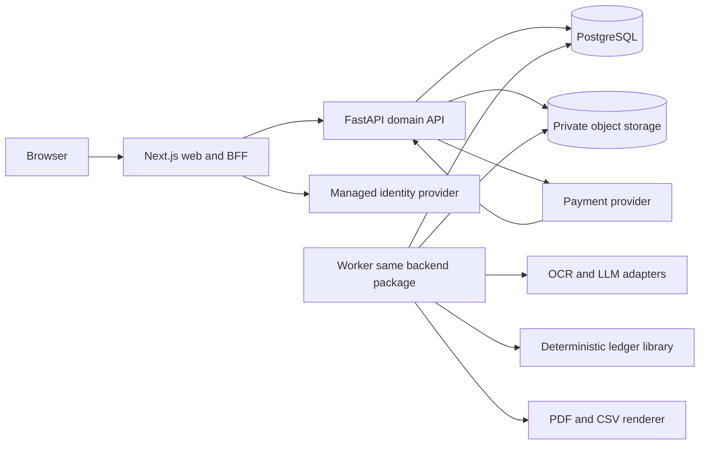
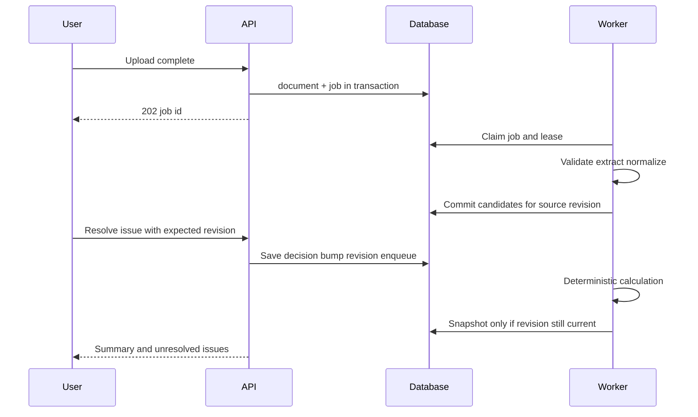

# Архитектура RenoLedger

## Структура системы

Один backend как модульное приложение, отдельный worker из того же кода, один PostgreSQL и приватное объектное хранилище. Это позволяет разделить HTTP и длительную обработку без сети микросервисов. Реализация ещё не создана.



Browser получает временный upload URL только после авторизации; фактические байты может передавать напрямую в quarantine storage. На схеме это дополнительный data path, минующий BFF. Право просматривать исходники проверяется сервером отдельно.

## Выбранный стек

| Слой | Выбор | Причина |
|---|---|---|
| UI | Next.js App Router, TypeScript, React, доступные компоненты | Документы, формы, источник и таблицы в браузере |
| BFF | Тонкие Next.js route handlers | Cookie session и проксирование; без финансовой логики |
| API | Python, FastAPI, Pydantic strict schemas | Типизированные контракты и удобная обработка документов |
| Persistence | PostgreSQL, SQLAlchemy, Alembic | Транзакции, связи, история и очередь первого этапа |
| Worker | Отдельный процесс того же Python приложения | OCR/LLM/экспорт переживают завершение HTTP-запроса |
| Files | Приватное S3-compatible storage | Исходники, страницы и отчёты с ограниченным доступом |
| Auth | Managed OIDC provider, серверная сессия BFF | Не разрабатывать хранение паролей самостоятельно |
| AI | Provider-neutral adapter с JSON Schema | Замена провайдера и измерение стоимости без изменения ledger |
| Payments | Hosted checkout и проверенные webhooks | Провайдер выбирается после проверки доступности аккаунта продавца |
| Tests | pytest, Hypothesis, Playwright, API contract validation | Инварианты денег, изоляция, сквозные сценарии |

Точные стабильные версии зависимостей фиксируются lockfile при старте реализации после проверки совместимости. Разработка документации выполнена с локальным Python 3.10; это не решение о production runtime. Предпочтение для реализации — поддерживаемая stable Python 3.12+ и поддерживаемая LTS Node, доступные хостингу; проверить версии в этапе DEV-01.

## Модули backend

`identity` проверяет access context; `cases` хранит границы сверки; `documents` управляет uploads и evidence; `extraction` вызывает adapters; `normalization` создаёт кандидатов; `ledger` считает; `review` управляет вопросами/решениями; `reports` создаёт snapshots; `orders` обрабатывает manifest/платежи; `jobs` исполняет очередь; `telemetry` агрегирует затраты; `privacy` удаляет данные.

Ledger — pure domain package без сетевых вызовов, OCR, UI или SQL. Его вход — строго валидированный выбранный набор нормализованных событий, выход — суммы, происхождение и предупреждения. Запись решения пользователя и постановка recalculation job выполняются в одной DB-транзакции.

## Pipeline

1. Авторизованный запрос создаёт immutable document id и upload attempt.
2. Сервер выдаёт краткоживущий URL для уникального quarantine key. Клиент сообщает о завершении.
3. Worker проверяет размер, MIME по содержимому, checksum, страницы и пригодность. Парсер запускается в изоляции с лимитами памяти/времени и без произвольного сетевого доступа.
4. Принятые байты копируются в immutable final key либо фиксируется неизменяемая версия объекта. Нельзя продолжать читать изменяемый upload key: presigned URL может использоваться повторно до истечения срока.
5. Native text извлекается по страницам; OCR применяется к нужным страницам. Evidence хранит страницу, диапазон текста и bbox при наличии.
6. LLM возвращает кандидатов по `extraction.schema.json`. Текст документа — данные, не инструкции для приложения. Модель не вызывает платежи, рассылки или произвольные URL.
7. Валидаторы проверяют схему, денежные форматы, суммы строк, доказательства и тип начисления. Некорректный ответ не коммитится как факт.
8. Normalization предлагает версии, связи и вопросы; неясности получают явную причину.
9. Пользователь фиксирует решения на конкретной case_revision. Значимые изменения инвалидируют зависимые проверки.
10. Ledger создаёт immutable snapshot; renderer формирует PDF/CSV из этого snapshot, а не пересчитывает иначе.



## Очередь и согласованность

PostgreSQL jobs используют короткий `SELECT ... FOR UPDATE SKIP LOCKED`, lease и `available_at`. Транзакция claim завершается до сетевого OCR/LLM-вызова. Worker отправляет heartbeat, просроченный lease возвращает работу в очередь. Один и тот же job может исполниться несколько раз; effect deduplication обеспечивается уникальным job_key и идемпотентной записью результатов.

Ключ извлечения: document_version + content_hash + extractor_version + schema_version. Ключ расчёта: case_id + case_revision + rules_version. При публикации проверяется ожидаемая ревизия: устаревший результат сохраняется диагностически или отбрасывается, но не становится latest.

Все мутации case выполняются под короткой блокировкой case row и expected_revision. Deadlock/transient failure повторяется ограниченно. Любая смена фактов, связей, принятой версии и cutoff увеличивает revision. Изменение профиля без влияния на расчёт не обязано её менять.

Ретраи внешних вызовов ограничены попытками и бюджетом; exponential backoff с jitter. Ошибки формата, неподдерживаемые документы и бюджетный лимит не ретраятся бесконечно. FastAPI BackgroundTasks не используется как надёжная очередь тяжёлой обработки.

## Auth и границы доверия

BFF хранит secure HttpOnly session cookie, backend принимает короткоживущий подписанный access token. API проверяет подпись, issuer, audience и expiration; owner_id никогда не берётся из тела запроса. Серверные cookie-мутирующие маршруты требуют CSRF-защиты и проверки Origin. Не хранить refresh token в localStorage.

Все repository methods получают access context. Запросы ограничены tenant_id; child object дополнительно связан с авторизованным case. Operator grant отдельный, ограничен case и сроком, не превращает оператора в глобального администратора. Demo имеет отдельный namespace/tenant и не принимает клиентские идентификаторы из другого окружения.

## Развёртывание

Локально: web, API, worker, PostgreSQL и S3-совместимый эмулятор в Docker Compose. Staging и production имеют разные БД, buckets, identity/payment secrets. Для production — managed Postgres, private storage, контейнерные API/worker, TLS и managed identity. Конкретные аккаунты, регионы и расходы — решения перед подключением, не созданные ресурсы.

API stateless; worker concurrency регулируется бюджетом. Начально достаточно одного worker процесса с малой конкурентностью. Масштабировать очередь/отдельные сервисы только после метрик. Миграции запускаются один раз отдельным release job. Rollback приложения должен читать совместимую схему; разрушительные изменения — через expand/contract.

## Предлагаемая структура будущего репозитория

```text
apps/web/                    # Next.js UI and thin BFF
services/backend/app/
  api/ identity/ cases/ documents/ extraction/
  normalization/ ledger/ review/ reports/ orders/
  jobs/ privacy/ telemetry/
services/backend/migrations/
services/backend/tests/
infra/                       # compose and deployment manifests
contracts/ fixtures/ docs/  # this specification
```

Структура — план. Эти каталоги приложения не созданы документацией.

## Источники технических решений

[FastAPI Background Tasks](https://fastapi.tiangolo.com/tutorial/background-tasks/) — граница in-process background tasks; [PostgreSQL locking](https://www.postgresql.org/docs/current/explicit-locking.html) — транзакционные блокировки; [Next.js Route Handlers](https://nextjs.org/docs/app/getting-started/route-handlers) — слой BFF; [S3 presigned URLs](https://docs.aws.amazon.com/AmazonS3/latest/userguide/using-presigned-url.html) — ограниченные по времени ссылки и повторное использование ключа. Архитектура очереди и ledger — проектное решение RenoLedger, не готовая гарантия этих продуктов.
