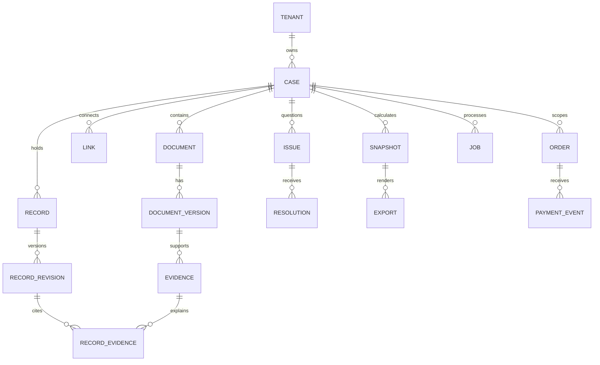

# Модель данных

**Реализация этапа 6:** гостевые сессии, проекты, задания, transfer tickets, отдельный аудит решений и очередь удаления объектов находятся в PostgreSQL-схеме `guest_review`. Исходники — в приватном object storage. Срок 24 часа, авторизация по хешу случайного секрета сессии; UUID проекта не даёт доступа. См. [фактический контракт](../planning/GUEST_REVIEW_CONTRACT.md) и `services/backend/app/guest/schema.sql`. Следующая исходная модель постоянных tenant/case остаётся проектной, а не утверждением о реализованной регистрации.

Модель описывает PostgreSQL-схему для реализации миграциями. Это не применённая БД. UUID — внутренние идентификаторы; денежные значения — BIGINT cents; серверные даты — timestamptz; исходные даты — date с контекстом. Все бизнес-таблицы содержат tenant_id, created_at и собственный id.

## Связи

## Сущности и поля

| Таблица | Существенные поля и назначение |
|---|---|
| tenants | id, owner_subject уникальный у identity provider, status, retention_policy_version |
| cases | tenant_id, contractor_display_name, currency='USD', cutoff_date, purpose, revision, status, latest_snapshot_id |
| documents | case_id, logical_name, document_kind, active_version_id; логическая группа версий |
| document_versions | case_id, document_id, version_no, content_hash, immutable_storage_key, MIME, bytes, pages, ingestion_status, extracted_at |
| evidence | case_id, document_version_id nullable, page nullable, bbox nullable, text_range, csv_row nullable, short_quote, source_type, actor_id; неизменяемая ссылка на источник |
| extractions | case_id, document_version_id, extractor_version, schema_version, raw_output_key, validation_status, usage/cost, unique extraction_key |
| records | case_id, kind, current_revision_id; стабильная идентичность финансовой записи |
| record_revisions | case_id, record_id, number, kind, amount_cents nullable, currency, effective_date, payload, independent evidence/review/lifecycle flags, actor_id, reason |
| record_evidence | case_id, record_revision_id, evidence_id, relation_type; несколько доказательств одной записи |
| links | case_id, from_record_id, to_record_id, kind, amount_cents nullable, status, basis_revision, evidence_ids, superseded_by |
| issues | case_id, code, priority, affected_record_ids, impact_cents nullable, affected_metrics, status, basis_revision |
| resolutions | case_id, issue_id, answer, actor_id, actor_role, scope_of_verification, basis_revision, evidence_ids, invalidated_at |
| snapshots | case_id, case_revision, rules_version, input_fingerprint, input_manifest, result_json, status; immutable после создания |
| exports | case_id, snapshot_id, format, object_key, checksum, status, expires_at |
| orders | case_id, snapshot_goal, cutoff_date, manifest_hash, offered_price_cents, currency, state, human_review_disclosed, terms_version |
| payment_events | order_id, provider, provider_event_id unique, event_type, amount_cents, payload_hash, received_at; не путать с платежами подрядчику |
| jobs | case_id, job_key unique, type, expected_case_revision, payload, status, attempt, lease_owner, lease_until, available_at, last_error_code |
| idempotency_keys | tenant_id, route, key, request_hash, response_reference, expires_at |
| audit_events | case_id nullable, actor, action, object_type/id, before/after reference, revision, reason; без копий полных документов |
| support_grants | case_id, operator_subject, purpose, consent_at, expires_at, revoked_at |
| usage_events | case_id nullable, job_id nullable, stage, provider, units, cost_estimate, actual_cost nullable, human_seconds, attribution |
| deletion_requests | tenant_id, case_id nullable, state, requested_at, completed_at, provider_cleanup_state, backup_expiry_at |

Крупный OCR-текст и raw model output хранятся как приватные объекты с той же политикой удаления. В БД находятся структурированные данные и короткие необходимые фрагменты.

## Независимые признаки достоверности

Нельзя объединять эти поля в один status:

| Измерение | Значения |
|---|---|
| origin | document, bank_record, user_statement, derived |
| extraction_review | unreviewed, checked, corrected; кто проверил и что |
| semantic_review | unknown, user_asserted, reviewed_for_calculation |
| link_review | proposed, accepted, rejected, invalidated; относится к конкретной link |
| lifecycle | active, superseded, void, stale |
| conflict | zero or more issue ids |

`reviewed_for_calculation` не означает юридически подтверждённую обязанность. Проверка числа и выбор трактовки начисления — разные review actions с actor, timestamp, evidence и basis_revision.

## Record kinds и payload

- agreement_base: amount_cents, replaces_record_id, included_adjustment_ids, scope_text.
- commitment_adjustment: signed amount_cents, approval_origin, effective_date, included_in_base_id nullable.
- billing_entry: signed amount_cents, invoice_number, billing_basis, coverage_ids, replaces_entry_ids, gross_total_cents/previous_billed_cents nullable.
- payment_request: requested_now_cents, invoice_record_id, prior_payments_mentioned_cents, terms_reference; не изменяет B напрямую.
- cash_event: signed amount_cents, state, payer_type, method, transaction_fingerprint, external_account_fingerprint, original_transaction_id nullable.
- payment_terms: due_date, stage_description, stage_amount_cents nullable, acceptance_condition, condition_satisfaction, satisfaction_origin.
- owner_purchase: line amounts, selected_lines, prorated tax/shipping with method, linked_commitment_adjustment_id nullable.

Payload валидируется отдельной Pydantic/JSON-схемой по kind. Произвольный JSON не заменяет проверку бизнес-правил.

## Ограничения целостности

1. У child-таблиц составной FK `(tenant_id, case_id)` к case; связи document/record/evidence должны указывать на объекты того же case. UUID сам по себе не обеспечивает изоляцию.
2. `(document_id, version_no)` и `(record_id, revision_no)` уникальны. Один active_revision pointer на логический объект.
3. Изменения version pointers и увеличение case.revision в одной транзакции под case lock.
4. После записи snapshot нельзя менять result_json; новый расчёт создаёт новый snapshot.
5. Allocation проверяет типы концов, валюту, направление, сумму и lifecycle. Суммарные ограничения проверяются под блокировкой записей/события, не только CHECK одной строки.
6. В документальном состоянии completed денежных событий отсутствующий amount не допускается. Неизвестная сумма остаётся кандидатом, не признанным cash event.
7. Idempotency key при повторном запросе с иным request_hash возвращает conflict.
8. Внешний provider_event_id уникален; повтор webhook не создаёт второй entitlement.
9. Запись tenant_id не принимается от клиента. Операторский доступ требует действующего grant на этот case.
10. Аналитика не содержит адреса, получателей переводов, имён файлов, текстов чеков или коротких цитат.

## Индексы и хранение

Индексы: tenant/case для каждого списка; `(case_id, effective_date)` для истории; `(case_id, status, priority)` для вопросов; `(status, available_at)` для очереди; `(case_id, case_revision, rules_version)` для snapshots; уникальные ключи внешних платежных событий и извлечений.

Fingerprint не заменяет исходный источник. Audit не должен бессрочно сохранять клиентские данные после удаления: финансовые ссылки и payload удаляются/обезличиваются по политике, минимальные security events сохраняются только в объявленном объёме. Платёжные бухгалтерские записи провайдера имеют отдельную политику и не требуют хранить документы ремонта.

## Состояния

Case: draft → collecting → reviewing → snapshot_ready; возможны needs_input, processing_failed, archived, deletion_pending, deleted. snapshot_ready означает технически сформированную сводку, а не отсутствие неизвестных.

Job: queued → running → succeeded; временная ошибка → retry_wait; терминальная → failed; удаление case → cancelled. Lease expiry возвращает в очередь в пределах attempt/cost limits.

Order: draft_offer → offered → payment_pending → paid → in_progress → delivered; отдельно cancelled/refund_pending/refunded. Исправление ошибки результата не меняет paid order на новый заказ. Provider state и внутреннее состояние обновляются транзакционно с audit.
